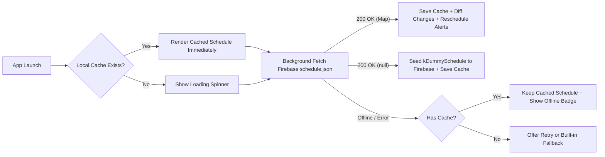

# Campus-Ready Improvements Plan (BSIT 3 - G1 Timetable Viewer)

## Goal Description
Enhance the **BSIT 3 - G1** read-only timetable app for real-life daily campus scenarios—weak campus Wi-Fi, rushing between rooms, checking vacant breaks, and catching sudden room or online modality changes—while strictly preserving the **single-section, read-only architecture** (no authentication, no CRUD forms, backed by Firebase Realtime Database REST API + 10-minute pre-class local notifications).

---

## User Review Required

> [!IMPORTANT]
> **Scope Guardrails:** All proposed additions remain **100% read-only** and specific to **BSIT 3 - G1**. Updates to rooms, schedules, and `statusNote` advisories continue to come exclusively from Firebase Realtime Database (`schedule.json`), with local storage used only to cache the fetched schedule offline.

> [!NOTE]
> **Dependency Addition (`path_provider`):** To persist the last fetched Firebase schedule across app restarts on weak/offline campus Wi-Fi, this plan proposes adding `path_provider: ^2.1.6` (already resolved in the local pub cache) alongside `dart:io` JSON caching, with an injectable cache interface for deterministic widget tests.

## Open Questions

> [!IMPORTANT]
> Please confirm your preferences on these three design choices before implementation:
> 1. **Notification Bell Sheet:** Should the bell icon on `TodayScreen` keep the reminder lead time strictly fixed at **10 minutes** (matching `README.md`) while showing the next upcoming alert + Firebase sync status, or also allow choosing between `5 / 10 / 15 min` locally?
> 2. **Vacant Break Cards Placement:** Should vacant break / back-to-back connectors appear on **both** `TodayScreen` (when the `All` filter is active and search is empty) and `WeeklyScreen` timeline, or only on `WeeklyScreen`?
> 3. **Room Building/Floor Hints:** Currently `dummy_data.dart` uses codes like `NGE204`, `GLE202`, `Case Room`, `Online`, and `TBA`. Should the UI display parsed floor/modality tags (e.g., `NGE · 2F`, `Online`, `Room TBA`) without assuming full building names, or would you like to provide official CIT-U building labels for `NGE` and `GLE`?

---

## Proposed Changes

### 1. Offline-First Caching & Sync Visibility (Weak Campus Wi-Fi)

Currently, `HomeShell` in `lib/main.dart` fetches `schedule.json` on startup and falls back to hardcoded `kDummySchedule` if offline—losing any `statusNote` or room updates published to Firebase. There is also no pull-to-refresh or indicator showing whether data is live or cached.

#### [MODIFY] pubspec.yaml
- Add `path_provider: ^2.1.6` under `dependencies` for local file-system cache storage.

#### [NEW] lib/services/schedule_cache_service.dart
- Define `ScheduleSnapshot` (`classes`, `syncedAt`, `source` enum: `live`, `cache`, `bundled`) and `ScheduleChangeSummary` (detecting changed `room`, time, or `statusNote` values between cached and newly fetched sessions).
- Persist and load `schedule_cache.json` via `path_provider` (`getApplicationDocumentsDirectory`), with safe JSON error recovery and an optional `Directory Function()?` override for unit tests.

#### [MODIFY] lib/main.dart
- Update `HomeShell` to:
  - Load `ScheduleCacheService` first so the schedule opens instantly even with zero signal.
  - Perform a background/manual `refreshSchedule()` against `schedule.json` with `ScheduleSource` tracking (`live`, `cache`, `bundled`) and `lastSyncedAt`.
  - Pass `onRefresh`, `syncStatus`, and `changedSessionIds` down to `TodayScreen` and `WeeklyScreen`.
  - Show a non-intrusive snackbar when a sync detects an updated room or `statusNote` (and automatically reschedule `NotificationService`).

---

### 2. Rushing Between Rooms & Class Modality Cues

Currently, `FocusBentoCard` shows only the active or next class without telling a rushing student what comes right after, and rooms like `Online`, `TBA`, and `NGE204` share identical visual styling.

#### [NEW] lib/utils/schedule_helpers.dart
- Pure helper functions (easily unit-tested):
  - `classifyLocation(String room)`: distinguishes **Online** (`online` -> laptop icon + cyan accent), **TBA** (`tba` -> warning amber pill `"Room TBA"`), and **On-Campus Room** (extracts building prefix + floor hint when matching patterns like `NGE204` -> `2F`, `GLE202` -> `2F`, `NGE101` -> `1F`).
  - `computeTimelineItems(List<ClassSession> sortedClasses)`: interleaves classes with gap descriptors (`Back-to-back` when `gapMinutes < 15`, or `VacantBreak` with start/end time and duration when `gapMinutes >= 15`).
  - `findNextSessionAfter(List<ClassSession> sortedClasses, ClassSession current)`: returns the immediate next class and transition gap for the day.

#### [MODIFY] lib/screens/today_screen.dart
- **Focus Bento Card Enhancement:**
  - When a class is **Ongoing**, display a compact bottom/sub-line inside the yellow card (or directly beneath the 2-column bento row) showing the next transition: e.g., `Next · RIZAL031 at 3:00 PM (TBA)` or `Done for today after this`.
  - When currently inside a **vacant break** between classes, show the remaining break duration and next class room clearly (`Starts in 45 min · Room TBA`).
- **Pull-to-Refresh & Sync Chip:**
  - Wrap the `ListView` in `RefreshIndicator` (using `AlwaysScrollableScrollPhysics`) and add a compact status chip/subtitle (e.g., `Live · Synced just now` or `Offline · Cached`) tappable to retry sync.

#### [MODIFY] lib/widgets/class_card.dart
- Add subtle modality & floor chips using `classifyLocation(session.room)` (e.g., `Online` icon badge, `Room TBA` amber indicator, or `2F` floor hint beside `NGE204`) on both standard and compact cards.

---

### 3. Vacant Break & Back-to-Back Transition Indicators

Currently, `BSIT 3 - G1` has multiple 1h 30m–3h 00m gaps (Mon, Wed, Thu, Sat) as well as a 0-minute back-to-back transition on Thursday (`1:30–3:00 PM` -> `3:00–4:30 PM`), all rendered identically.

#### [NEW] lib/widgets/break_connector_card.dart
- Lightweight, low-visual-noise timeline connector widget:
  - **Vacant Break (`>= 15 min`):** Dashed/subtle card showing coffee/break icon, duration, and window (e.g., `1h 30m vacant break · 1:30 PM – 3:00 PM`).
  - **Back-to-Back (`< 15 min`):** Slim inline pill (`Back-to-back · 0m break` or `10m transition`) alerting the student to move immediately.

#### [MODIFY] lib/screens/today_screen.dart & lib/screens/weekly_screen.dart
- Render `BreakConnectorCard` between consecutive classes in `WeeklyScreen` and in `TodayScreen` (only when `_filter == _TodayFilter.all` and `_query.isEmpty` so filtered/search views stay clean).

---

### 4. Sudden Room & Online Modality Changes (`statusNote` Visibility)

Currently, `ClassCard(compact: true)` in `WeeklyScreen` hides `statusNote`, `TodayScreen` has no top-level advisory notice, and `ClassDetailsSheet` places `Note` at the very bottom.

#### [MODIFY] lib/widgets/class_card.dart
- Update `_buildCompactCard` so that whenever `session.statusNote` is non-empty (or the session changed during the latest sync), it renders:
  - An amber/orange `UPDATE` or advisory badge + single-line `statusNote` preview inside the compact card so changes are immediately visible on `WeeklyScreen`.

#### [MODIFY] lib/screens/today_screen.dart
- Add a dismissible/tappable **Class Advisory Banner** directly above the filter pills whenever one or more of today's classes has a `statusNote`, listing the affected course code and note and opening `ClassDetailsSheet` on tap.

#### [MODIFY] lib/widgets/class_details_sheet.dart
- Move `statusNote` into a high-visibility **Advisory Card** directly below the header (instead of at the bottom) when present.
- Add a read-only **Copy Class Info** button (using `Clipboard.setData`) to quickly copy course code, schedule, room, and any advisory note.

---

### 5. Actionable Reminders & Sync Sheet (Bell Icon)

Currently, tapping the bell icon on `TodayScreen` displays only a static `SnackBar`.

#### [NEW] lib/widgets/reminders_sync_sheet.dart
- Read-only modal bottom sheet opened from the `TodayScreen` bell icon showing:
  - **Next Scheduled Alert** (e.g., `RIZAL031 · Reminder at 2:50 PM (10 min before)`).
  - **Permission Health** (whether notifications & exact alarms are granted, with clear guidance if disabled).
  - **Schedule Sync Info** (`Last synced`, source badge `Firebase Live` / `Cached Offline`, and a `Sync Schedule Now` button).

#### [MODIFY] lib/services/notification_service.dart
- Expose `getNextScheduledSummary(List<ClassSession> classes)` and `getPermissionStatus()` so `RemindersSyncSheet` displays accurate live reminder status.

---

## Verification Plan

### Automated Tests
1. Run static analysis and strict lints:
   - `flutter analyze --no-pub`
   - `dart analyze --fatal-infos --fatal-warnings`
2. Expand `test/widget_test.dart` (and/or add unit tests under `test/`) and run `flutter test`:
   - Unit tests for `ScheduleHelpers`: location classification (`NGE204`, `Online`, `TBA`), back-to-back vs. vacant break calculation, and next-class lookup.
   - Unit tests for `ScheduleCacheService`: write/read roundtrip, corrupted cache fallback, and change detection (`room` / `statusNote` diff).
   - Widget tests for `HomeShell` cache-first startup + offline badge + pull-to-refresh sync update.
   - Widget tests for `TodayScreen` advisory banner, vacant break connectors, and `RemindersSyncSheet`.
   - Widget tests for `WeeklyScreen` compact card `statusNote` visibility and 320px narrow-viewport overflow protection.

### Manual Verification
- Launch on an Android device/emulator:
  1. Load once with Wi-Fi enabled, toggle Airplane Mode, and restart the app -> verify the cached schedule (including any Firebase `statusNote` changes) opens immediately with an offline cache indicator.
  2. Restore Wi-Fi, pull down to refresh on `TodayScreen` / `WeeklyScreen`, and verify live sync updates the timestamp and surfaces any modified `room` or `statusNote`.
  3. Tap the Bell icon to verify `RemindersSyncSheet` displays the next 10-minute reminder and sync timestamp.
  4. Tap a class with a `statusNote` to verify the prominent Advisory card and `Copy Class Info` action in `ClassDetailsSheet`.
